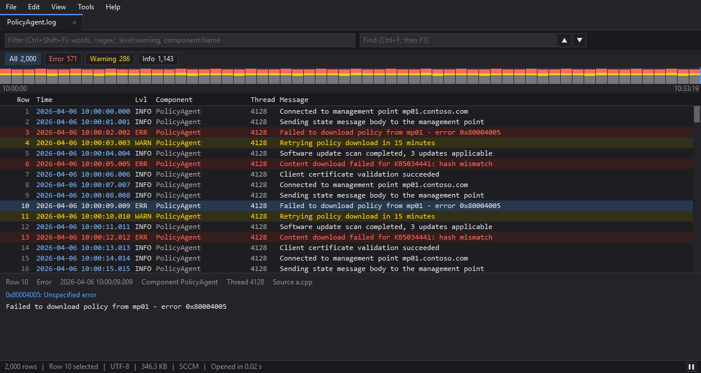
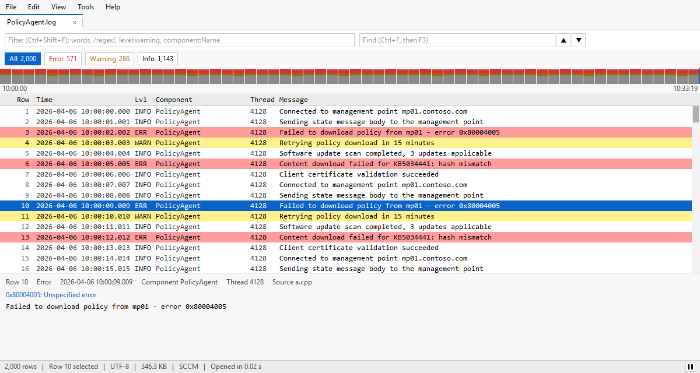

# TraceView for Windows

[](https://buymeacoffee.com/thefinder808)

A fast, customizable Windows log viewer inspired by CMTrace, and the counterpart to the [macOS TraceView](https://github.com/thefinder808/TraceView).

**It's built for AI agents too.** Its command line lets agents such as Claude Code and Codex investigate logs without reading them whole. A summary of a folder lists each problem once, with its error codes explained, and a query returns only the rows asked for, one short line each. So an agent spends far fewer tokens than it would opening or searching the logs itself, and that adds up when you're analyzing logs day after day. [With an AI agent](#with-an-ai-agent) says how to set it up in one step.



It's one signed EXE with nothing to install, so it can be copied to a USB stick or an admin share. It opens multi-gigabyte logs in seconds and follows them as they're written. It draws without needing a GPU, so it stays quick over RDP.

**This is a beta.** It's been tested on Windows 11. It's built for Windows 10 1809, Server 2019 and later, but hasn't been tried there or with Narrator yet.

## Features

- **Built for AI agents:** a command line that summarizes and searches logs in short lines or JSON, so agents read only what matters, and `traceview setup` to get Claude Code, Codex, the ChatGPT app and GitHub Copilot using it.
- **CMTrace's habits:** severity colors, live tail, find, filter, Error Lookup on Ctrl+L, tabs, merging logs into one timeline, and the Classic theme.
- **Reads the logs admins open:** ConfigMgr client and site server logs, Intune's, CBS, DISM and setup logs, Windows Update's `WindowsUpdate.log` and `ReportingEvents.log`, Windows Installer, WiX and Visual Studio installers, Office Click-to-Run, PowerShell transcripts, `setupapi`, IIS, Windows Firewall, Group Policy's `gpsvc.log`, `netlogon.log`, winget's and syslog, with times, levels and components in their columns. Any other format can be taught in Tools > Log formats.
- **TraceView's own:** severity chips, the event histogram, a sidebar of nearby and Windows logs, bookmarks, filter presets, split view, a command palette and five themes.
- **Yours to change:** highlight rules, columns, fonts, keyboard shortcuts, custom log formats, theme files and named layouts. All of it is plain text that loads as it's edited.
- **Accessible:** screen readers get every control through UI Automation, everything works from the keyboard, and Windows contrast themes are followed.



## Download

Each [release](https://github.com/thefinder808/TraceView-Windows/releases) has a zip for x64 PCs, one for ARM64 PCs, and `SHA256SUMS.txt`. From 0.13, each EXE is there on its own too, for updates to download.

1. **Unzip it** anywhere and run `traceview.exe`. Nothing is installed until you ask.
2. **Check the signature** if you like: Properties > Digital Signatures should show *Nathaniel Graham*, verified by Microsoft.
3. **Check the download** against `SHA256SUMS.txt`, if you like:

   ```powershell
   Get-FileHash TraceView-0.15.0-x64.zip
   ```

   The hash it prints should match that zip's line in `SHA256SUMS.txt`. PowerShell prints it in capitals, but the letters are the same.

## Installing

To install it, choose Install TraceView... on the start page, or Tools > Install TraceView..., or run `.\traceview.exe install` from the EXE's folder. It says what it will change and asks first. For your Windows account only, and with no administrator rights, it:

- copies TraceView to `%LOCALAPPDATA%\Programs\TraceView`, where it keeps itself up to date;
- adds it to the Start menu, so typing TraceView in Start opens it;
- adds that folder to your PATH, so `traceview` works in new terminals;
- lets it open `.log`, `.lo_` and `.evtx` files, then opens Windows' Default apps page at TraceView. Windows doesn't let a program make itself the default, so choose TraceView there for each kind of file it should open. Right-clicking a log, then Open with > Choose another app > TraceView > Always, does the same for one kind.

Tools > Uninstall TraceView..., or `traceview setup --remove`, takes it all back.

## Updates

The copy that installing, or setting up for AI agents, puts in `%LOCALAPPDATA%\Programs\TraceView` keeps itself up to date. Once a day, and when you choose Help > Check for updates, the viewer looks for a newer release on GitHub and installs it in the background. The new version starts the next time you open TraceView, and Help > What's new shows what changed.

A download is used only once it matches the release's `SHA256SUMS.txt`, Windows trusts its signature, it's signed by the same publisher as the copy that's running, and the version inside it is the one listed. Only a newer version is ever installed. The command line never checks, so a command an AI agent is running is never interrupted.

A copy kept anywhere else is told about a new version but not replaced. A copy that isn't a signed release, such as one built from source, never checks.

To turn the daily check off, uncheck Help > Check for updates automatically. To turn checks off for everyone on a PC, set a DWORD named `DisableUpdates` to `1` under `HKEY_LOCAL_MACHINE\SOFTWARE\Policies\TraceView`, as Group Policy or Intune can. Under `HKEY_CURRENT_USER`, it turns them off for one user.

## Using it

The start page opens recent logs and folders, and this PC's usual log folders, such as ConfigMgr's and Intune's, with one click. You can also open a log from File > Open or Ctrl+O, drop files on the window, or pass one on the command line, here from the EXE's folder in PowerShell:

```powershell
.\traceview.exe C:\Windows\Logs\CBS\CBS.log
```

| Keys | Action |
|---|---|
| Up, Down, Page Up, Page Down, Home, End | Move the selection |
| Shift with any of those, or Shift+click | Extend the selection |
| Ctrl+Up, Ctrl+Down, mouse wheel | Scroll without moving the selection |
| Left, Right, Shift with the mouse wheel | Scroll sideways, to read rows too long for the window |
| Ctrl+A, Ctrl+C | Select all, copy as tab-separated text |
| Ctrl+O | Open logs, each in its own tab |
| Ctrl+Shift+O | Open a folder, such as one of logs copied from another PC. Its logs are listed with their errors and warnings, and a click opens one. Dropping a folder does the same |
| Ctrl+Tab, Ctrl+1-9, Ctrl+W | Switch tabs, close a tab |
| Ctrl+F, F3, Shift+F3 | Find, and move between matches, as the ▲ and ▼ buttons beside Find do. The × in the box clears it |
| Ctrl+Shift+F | Filter, as in `failed level:warning component:PolicyAgent` or `/regex/`. The × in the box clears it, showing every row again |
| Ctrl+E, Ctrl+Shift+E | Next and previous error |
| Ctrl+L | Error Lookup |
| Ctrl+H | Highlight rules: color or mark rows that match, as in `download failed level:error` |
| Drag a header, or its edge | Move or resize a column. Right-click the header, or use View > Columns, to show and hide them |
| Ctrl+Plus, Ctrl+Minus, Ctrl+0, Ctrl+wheel | Larger, smaller or default log text. View > Fonts and row spacing picks fonts and the space between rows |
| Ctrl+K | Command palette: every command, open tab, recent log and preset |
| Ctrl+G | Go to a row |
| Ctrl+D, F2, Shift+F2 | Toggle a bookmark, then step through them |
| Right-click a row, Shift+F10 | The row's menu: add or remove its bookmark, or copy the selected rows |
| Ctrl+B | Sidebar |
| Ctrl+\ | Split view, with Ctrl+Shift+S to sync the panes by time. With one log open, it asks for the log to show beside it |
| Ctrl+U | Pause live updates, as the pause button at the end of the status bar does, which shows ▶ while paused. End goes back to following new rows, ending a pause |
| Ctrl+Shift+M | Merge the open logs into one timeline |
| Alt or F10 | The menus |

Every shortcut here can be changed, and any command can be given one, in Tools > Keyboard shortcuts.

- **Logs TraceView doesn't know** can be taught to it in Tools > Log formats, with a regex whose named groups say where the time, level, component, thread, source and message are.
- **Layouts:** View > Layout: CMTrace hides everything but the grid and details pane, and Layout: Everything shows every pane. View > Save layout as... names the panes you have open, to switch back to later.
- **Themes:** View > Edit theme changes any color of the theme in use, with the window recoloring as you type. Editing a built-in theme makes a copy, saved as a small file in the `themes` folder. Copy a file into that folder to share a theme.
- **Double-clicking `.log` files:** [Installing](#installing) offers TraceView for `.log`, `.lo_` and `.evtx` files and opens Windows' Default apps page to choose it. Tools > Use TraceView for .log files... does just that part, for the installed copy if there is one.

## Settings and portable copies

Settings live in `traceview.toml`, and themes in the `themes` folder beside it, in `%APPDATA%\TraceView`. Both can be edited by hand while TraceView runs, and load within a second.

For a portable copy, put a `traceview.toml` beside the EXE, even an empty one. TraceView then keeps its settings and themes in that folder instead, and they travel with it. The index cache for big logs stays on each PC, as the next section says.

## The command line

The same EXE searches, summarizes and traces logs, with results as JSON or short lines:

```powershell
.\traceview.exe query C:\Windows\Logs\CBS\CBS.log --text "failed" --min-level warning --limit 20 --pretty
```

```powershell
.\traceview.exe summarize C:\Windows\Logs\CBS\CBS.log --pretty
```

Both take several logs, or a folder, which means the logs directly in it, or in its subfolders too with `--recurse`. A query of several logs merges them into one timeline by time, with each row naming its log. A summary of several lists the logs with errors or warnings, worst first, and the worst problems across all of them. It counts a log's rotated copies as part of it, so `AppEnforce.lo_` and `AppEnforce-20261020-123456.log` add to `AppEnforce.log`, and an error repeated across them is one problem. `--current-only` leaves rotated copies out, `--with-history` adds a named log's copies, and `summarize --from` and `--to` cover only a time range:

```powershell
.\traceview.exe summarize C:\Windows\CCM\Logs
```

```powershell
.\traceview.exe query C:\Windows\CCM\Logs --from 2026-11-05T10:10 --to 2026-11-05T10:20 --format lines
```

Times can leave out the seconds, and as a `--to`, a time without seconds takes in that whole minute, as a bare date takes in that whole day.

A summary also lists the longest gaps of a day or more with no rows, which for a folder means no rows in any log, as when a PC was off or asleep for weeks. Rows that `--exclude` leaves out still count, since any row shows the PC was on.

Some ConfigMgr problems are only ever logged as info, so a summary's problem patterns, which are warnings and errors, never show them. `summarize --symptoms` also looks for a few such signs seen in real troubleshooting, such as an update assignment `already in progress state`, and says what each can mean. It's off unless asked for, as some, such as `Total actionable updates = 0`, are common in healthy logs too.

```powershell
.\traceview.exe summarize C:\Windows\CCM\Logs --symptoms --format lines
```

`--format lines` gives one short line per row instead of JSON, at under half the size, and each row starts with its log and row number, as in `CBS.log:11503`. For a summary, it gives a line per log with problems and per problem pattern, at about a third of the JSON's size.

To see what happened last, `--newest-first` starts from the end, so `--limit 10` gives the last ten matches:

```powershell
.\traceview.exe query C:\Windows\CCM\Logs\AppEnforce.log --min-level error --newest-first --limit 10 --format lines
```

`--context 5` adds the five rows before and after each match, from its own log, whatever the filters say, so you can see what led up to an error without opening the file. In lines, those rows are indented and `--` separates the groups, and matches close together share a group. In JSON, each match gets `before` and `after` lists:

```powershell
.\traceview.exe query C:\Windows\Logs\CBS\CBS.log --min-level error --context 5 --format lines
```

Lines can be trimmed further with `--fields time,message`, `--max-width 200` and `--no-header`. `summarize --no-examples` leaves the example rows out of the JSON.

`--count-by` counts the matches instead of listing them, by `day`, `hour`, `file`, `level`, `component` or `template`, which is the message with its numbers and codes taken out:

```powershell
.\traceview.exe query C:\Windows\CCM\Logs --text "upload" --count-by day --format lines
```

Each template comes with its first row as an example, and where that row is, so the versions, KB numbers and codes the template takes out are still there to read. `--no-examples` leaves them out:

```
2 Installing <n>-Zip <n>.<n> (MSI-x<n>) | AppEnforce.log:1234 Installing 7-Zip 26.04 (MSI-x64)
```

Give `--text` or `--regex` more than once, or both, to find only the rows matching every one, such as `--regex "26100\.9549" --text "Installed"`.

`--exclude` leaves out rows matching a regular expression, such as errors that are routine where you work. Give it more than once to leave out more. A summary says how many rows, errors and warnings it left out, so nothing goes missing silently:

```powershell
.\traceview.exe summarize C:\Windows\CCM\Logs --exclude "ReadStringFromFile failed" --exclude "PeerDistribution" --format lines
```

Some ConfigMgr entries span many lines, such as the WMI dumps in `CcmNotificationAgent.log` and `SCNotify.log`, so a search can match deep inside them and flood the results. `query --first-line` matches and shows only each row's first line, with a count of the lines left out, as in `Event object details: [+14 lines]`. It's off unless asked for, as the detail is sometimes in the body, such as an exit code.

`--unless-followed-by` finds what started but never finished: each match with no row containing that text after it, before the next match, in the same log. It finds the closing rows whatever other filters say, so an info row still closes an error:

```powershell
.\traceview.exe query C:\Windows\CCM\Logs\CcmExec.log --text "Entering CS mode" --unless-followed-by "Leaving CS mode" --format lines
```

Each match it finds says which of two very different things happened. Either the same thing started again before it finished, and whether that attempt finished, which means it was abandoned. Or it's still open at the end of its log, which may mean it's hung:

```
WUAHandler.log:812 … [started again at row 960 (09:46:45), which finished] | Async installation of updates started
WUAHandler.log:1307 … [still open at the end of the log] | Async installation of updates started
```

In JSON, each match has `unclosed`, either `started_again` with a `next_match`, or `still_open`, and the result counts each kind.

`trace` follows one ID, such as a deployment type, update or job GUID, through every log. It lists each row with that ID as one timeline, with each row's log, and folds runs of the same message from one log into one line that says how many. The ID can be given with or without braces, in any case. It takes query's options, such as `--recurse`, `--from`, `--to` and `--text` to narrow it:

```powershell
.\traceview.exe trace 3DA21691-E39D-4DA6-8A4B-B43877BCB1B7 C:\Windows\CCM\Logs --format lines
```

```
# Trace of "3DA21691-…": 412 rows in 7 logs, … as 57 lines, with runs of the same message folded. …
# In: AppDiscovery.log 120, AppEnforce.log 30, …
AppDiscovery.log:4 2026-11-16T08:53:14.000-06:00 INFO AppDiscovery 7 [2 more like it, to row 6 (08:53:18)] | Waiting for job …
```

Rows show the time as the log wrote it, plus its offset from UTC when the log says, as ConfigMgr and Intune logs do: `2026-11-01T01:30:00.000-05:00`. That keeps the hour repeated when clocks go back apart, and makes logs from PCs in other time zones safe to compare. `--from` and `--to` still use the log's own clock. IIS logs, which are written in UTC, are shown in this PC's time zone, so they line up with other logs.

`lookup` explains an error code with Windows' own text, including WMI's. Windows has no text for Windows Update (0x8024…) and Delivery Optimization (0x80D0…) codes, so for those it gives the code's name, such as `DO_E_DOWNLOAD_NO_PROGRESS`. Common servicing codes from CBS, DISM and Windows Update, such as 0x800F081F, get their names too, as in `CBS_E_SOURCE_MISSING`, with a short explanation in TraceView's own words. On a ConfigMgr client or site server, ConfigMgr's own codes (0x87D0…) and many Windows Update codes also get English text from the copy of CMTrace that ConfigMgr installs. On another PC, such as one you copy logs to, 27 of the most common ConfigMgr codes, such as 0x87D00324, still get a short explanation in TraceView's own words, marked with `TraceView` as its source, and the rest say where to get more: put a copy of `CMTrace.exe` in the folder holding `traceview.exe` for CMTrace's text. After `traceview setup`, that's `%LOCALAPPDATA%\Programs\TraceView`. TraceView only reads that file, and never runs it:

```powershell
.\traceview.exe lookup 0x80070005
```

`--help` lists every option, and `--licenses` shows the licenses of TraceView and the open-source parts it's built with.

### With an AI agent

Agents that can run commands, such as Claude Code, Codex, the ChatGPT app and GitHub Copilot CLI, read logs for far less with TraceView than by opening them. A summary of a whole logs folder is a few kilobytes, and summaries keep each problem's real error codes, looked up on your PC.

To set it up, choose Tools > Set up for AI agents..., or run this from the EXE's folder:

```powershell
.\traceview.exe setup
```

It says what it will change and asks first. For your Windows account only, and with no administrator rights, it:

- copies TraceView to `%LOCALAPPDATA%\Programs\TraceView`, and adds it to the Start menu;
- adds that folder to your PATH, so `traceview` works in new terminals;
- adds a skill for each of Claude Code, Codex, the ChatGPT app and GitHub Copilot that's installed. A skill tells the agent when and how to use TraceView, and the agent only reads it in full when a task is about logs.

Then restart your agent apps and terminals, unzip a PC's logs, and ask about them. To update TraceView, run setup again from the newer EXE. `traceview setup --remove`, or Tools > Uninstall TraceView..., undoes it all.

For any other agent, `traceview setup --print` or Tools > Copy instructions for AI agents gives the instructions to paste into its instructions file, such as `AGENTS.md`. Setup never edits those files itself.

In the ChatGPT app, ask in Codex, which runs commands on your PC.

What you give an AI service leaves your PC, and logs hold user, machine and server names. Summaries and filtered queries send much less of that than whole logs.

## Event logs

TraceView reads Windows event logs too: a saved `.evtx` file, including one on another PC's share, or one of this PC's logs by the name Event Viewer gives it.

In the viewer, File > Open event log... lists this PC's logs, such as System, Application and the ones Intune and Windows Update write, to open one by typing part of its name. A saved `.evtx` file opens like any log, from File > Open or by dropping it on the window. One of this PC's logs shows new events as they arrive, within a couple of seconds. On the command line, name them like this:

```powershell
traceview summarize eventlog:System
traceview query eventlog:Microsoft-Windows-TaskScheduler/Operational --min-level error
traceview query \\SRV01\c$\Windows\System32\winevt\Logs\Application.evtx --text "Application Error"
```

Each event is a row with its time in this PC's time zone, its level, and Event Viewer's Source, Event ID and Computer, which the command line calls the component, thread and source. Messages are the ones Event Viewer shows, from the message files of the software installed on this PC. An event this PC has no message for shows its own values instead. Logs this PC lets you read in Event Viewer work without administrator rights, but the files under `C:\Windows\System32\winevt\Logs` need them.

## Privacy

TraceView sends no telemetry and has no accounts, and your logs stay on your PC. The only thing it connects to is GitHub, to check for updates: once a day, and when you choose Help > Check for updates, the viewer asks for the latest release's `SHA256SUMS.txt`, and downloads a newer `traceview.exe` if there is one. GitHub sees this PC's address and the version of TraceView asking, as it would for any download. While checking a signature, Windows may also ask the certificate's authority, Microsoft, whether it was revoked, as it does before running a downloaded program. The command line never connects. [Updates](#updates) says how to turn checks off.

It only writes:

- its settings and themes, in `%APPDATA%\TraceView` or beside a portable copy;
- an index cache for logs of 64 MB or more, so they open faster the next time, in `%LOCALAPPDATA%\TraceView\indexes`. It holds row positions, levels and times, never log text, and is capped at 2 GiB;
- registry entries under `HKEY_CURRENT_USER` that let it open `.log`, `.lo_` and `.evtx` files, only if you install it or choose Tools > Use TraceView for .log files;
- a copy of itself in `%LOCALAPPDATA%\Programs\TraceView`, a Start menu shortcut in `%APPDATA%\Microsoft\Windows\Start Menu\Programs`, and that folder on your PATH, only if you install it or set it up for AI agents, which also writes a skill file for each AI agent found. Updates replace that copy, keeping the one before as `traceview.exe.old` until the next launch;
- `%LOCALAPPDATA%\TraceView\update-checked`, an empty file whose time says when it last checked for updates;
- a temporary text copy of each event log it reads, in `%TEMP%\TraceView`. The viewer deletes it when its tab closes. The command line deletes it as soon as it's open, which Windows finishes when the command ends. One left by a crash is cleared a day later.

## Removing it

1. If you installed it, or set it up for AI agents, choose Tools > Uninstall TraceView..., or run `traceview setup --remove`. That deletes the installed copy, its Start menu shortcut, PATH entry and file types, and the skills it wrote.
2. If you used Tools > Use TraceView for .log files with a copy you didn't install, choose Tools > Stop using TraceView for .log files.
3. Delete any `traceview.exe` you unzipped.
4. Delete `%APPDATA%\TraceView` and `%LOCALAPPDATA%\TraceView`.

## Building from source

Needs Rust and the Visual Studio C++ build tools, with the Windows SDK they include for its resource compiler.

```bash
cargo build --release -p traceview
```

```bash
cargo test --workspace
```

For ARM64 PCs, CI builds a native EXE on every push, kept as the `traceview-arm64` artifact. To build it yourself, add Visual Studio's ARM64 C++ build tools, then:

```bash
cargo build --release --target aarch64-pc-windows-msvc -p traceview
```

The design is in [the GUI design](docs/GUI-DESIGN.md) and [the architecture](docs/ARCHITECTURE.md).

### Checks

These need generated 5 GiB logs, which `check-perf.ps1` creates in the git-ignored `test-data/perf` folder.

```bash
pwsh -File scripts/check-perf.ps1
```

```bash
pwsh -File scripts/check-gui-perf.ps1
```

```bash
pwsh -File scripts/check-gui.ps1
```

### Releases

A `v*` tag builds, signs and drafts a release, as [docs/RELEASING.md](docs/RELEASING.md) describes. `pwsh -File scripts/build-release.ps1` makes the same zips locally, unsigned. Changes are listed in [CHANGELOG.md](CHANGELOG.md), and [SECURITY.md](SECURITY.md) says how to report a vulnerability.

## Support

TraceView is free and open source. If it saved you an hour of log-staring, you can [buy me a coffee](https://buymeacoffee.com/thefinder808). No pressure, always welcome.

## License

MIT, in [LICENSE](LICENSE). The licenses of the crates TraceView is built with are in [THIRD-PARTY-NOTICES.txt](THIRD-PARTY-NOTICES.txt), and `traceview --licenses` prints both.
